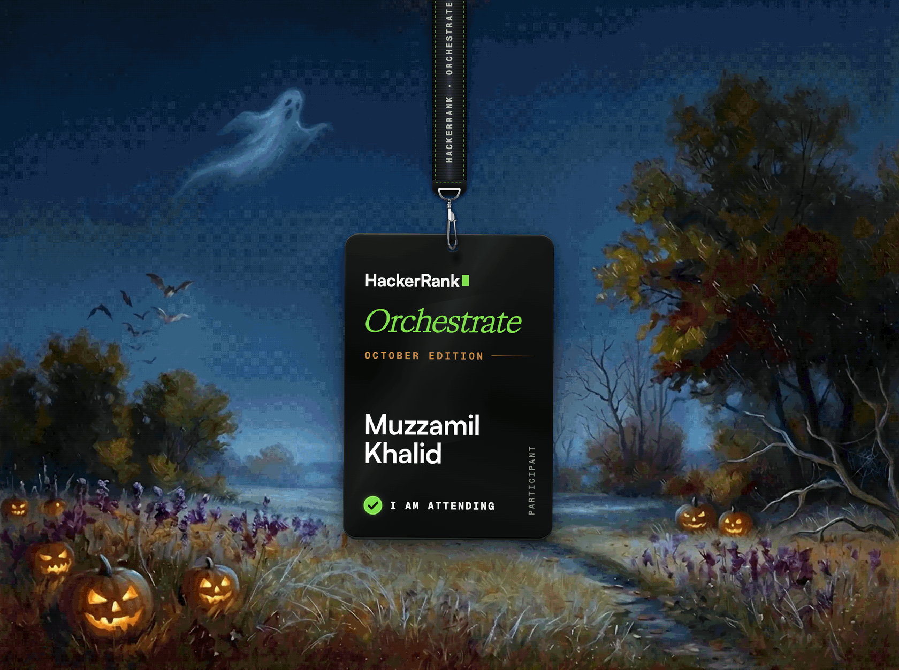

<p align="center">
  
</p>

<h1 align="center">Ghost Data Still Exists</h1>

<p align="center">
  <b>A deletion-audit agent that proves whether a person's data is really gone.</b><br>
  HackerRank Orchestrate · October 2026
</p>

<p align="center">
  
  
  
  
</p>

---

## The problem

A deletion workflow says **"Complete"**, but the person's data is still in a replica, a log line, a support attachment, a search index or a backup that can restore it. For each of 518 deletion requests, this agent:

1. decides whether the request **actually asks for deletion** (in any of 8 languages);
2. rebuilds the person's **current and past identities** (old emails, phones, email hashes);
3. reads every kind of evidence: SQL snapshots, JSON, logs, text, PDFs and screenshots, **as of the audit time only**;
4. applies the deletion policy per data category (delete, redact, anonymize, retain, tombstone);
5. returns `COMPLETE`, `INCOMPLETE` or `NOT_APPLICABLE` with an ordered, evidence-cited plan: **findings → remediation → verification**.

Full specification: [`problem_statement.md`](./problem_statement.md).

## Results

| | |
| --- | --- |
| Requests audited | **518** (+ 32 public samples) |
| Audited outcome | 355 INCOMPLETE · 153 COMPLETE · 10 NOT_APPLICABLE |
| Workflow said COMPLETE, data still present | **163 of 254** |
| Sample status accuracy | **32/32** |
| Sample step F1 / field accuracy | 0.977 / 96.5% |
| Custom evaluation cases | 8/8 pass |
| Model calls, tokens, cost per run | 0 · 0 · $0.00 |
| Run time | about 40 s on a laptop CPU |

Details: [`code/evaluation/evaluation_report.md`](./code/evaluation/evaluation_report.md) and [`code/evaluation/usage_report.md`](./code/evaluation/usage_report.md).

## Quick start

```bash
pip install -r code/requirements.txt   # one dependency: PyMuPDF (PDF text)
python code/main.py                    # audits every request, writes ./output.csv
python code/evaluation/main.py         # sample metrics + custom cases
```

No API keys, no network and no model calls are needed. Repeated runs produce byte-identical output.

### Built-in checks

Each command exits non-zero on failure.

| Command | What it proves |
| --- | --- |
| `python code/main.py verify` | Parsed evidence matches the raw files (7,228 checks) |
| `python code/main.py verify-stage2` | Intent, identity history and the `audit_at` cutoff (4,559 checks) |
| `python code/main.py validate-stage3` | Evidence rules and ownership on all 550 cases (11,965 checks) |
| `python code/main.py verify-stage4` | Steps vs samples and the full `output.csv` contract |

## How it works

```mermaid
flowchart LR
    A[Load CSVs + manifest] --> B[Parse evidence<br/>SQL · JSON · logs · text · PDF · screenshots]
    B --> C[Intent<br/>delete or not?]
    C --> D[Identity<br/>current + historical]
    D --> E[Cutoff<br/>only evidence ≤ audit_at]
    E --> F[Link + state<br/>who owns what, what state is it in]
    F --> G[Policy<br/>required state per category]
    G --> H[Status<br/>COMPLETE / INCOMPLETE]
    H --> I[Steps<br/>findings → remediation → verification]
    I --> J[(output.csv)]
```



| Stage | Module | Key idea |
| --- | --- | --- |
| Load and parse | `ghost/data.py`, `ghost/evidence/` | Every file becomes one `Observation` shape with the time it became available. SQL runs in SQLite, including replica topology. |
| Intent | `ghost/intent.py` | Multilingual rules; "keep / do not delete" beats "delete"; access, export and opt-out are not deletions. |
| Identity | `ghost/identity.py` | Current snapshot plus the identity audit log, rolled back to `audit_at`. |
| Cutoff | `ghost/timeline.py` | Evidence captured after `audit_at` can never change or support an answer. |
| Link and state | `ghost/linking.py`, `ghost/state.py` | Ownership from record content, catalog links, cross-references and lookups. Workflow "SUCCESS" messages are claims, never proof. |
| Policy and status | `ghost/audit.py` | Category → rule → required state; tombstones keep only the stable reference. |
| Steps and output | `ghost/steps.py`, `ghost/pipeline.py` | Flows disabled and restores blocked before records change; stable sort by phase, operation, system, resource. |

## Repository layout

```text
code/
  main.py               entry point: run + checks
  ghost/                the audit agent
  checks/               verification tools for each stage
  cache/images/         one-time screenshot transcriptions, locked to each image by SHA-256
  evaluation/           evaluation runner and reports
dataset/                challenge data (participant-facing only)
ghost_map/              interactive map of the pipeline and progress
output.csv              final predictions (518 rows)
problem_statement.md    challenge specification
```

## Output format

```text
case_id,deletion_status,steps_json
case_33,INCOMPLETE,"[{""step_no"":1,""phase"":""FINDING"",""system_id"":""export_service"",""resource_id"":""export_1260"",...}]"
```

Each step has `step_no, phase, system_id, resource_id, operation, state, evidence_id`. Findings cite the file, activity or audit record that proves them; proposed remediation and future checks have an empty `evidence_id`.

---

<p align="center">
  Built for <a href="https://www.hackerrank.com/contests/hackerrank-orchestrate-october26/challenges/ghost-data-still-exists">HackerRank Orchestrate · October 2026</a> by <b>Muzzamil Khalid</b>.
</p>
